# Amiga PiStorm32Lite IC2 LCD Display

When I bought my A1200net translucent Amiga 1200 case, and I saw the mounting point for a 1602LCD display, my goal was to use it for my Gotek drive. However in the end I decided on a combination LCD and rotary switch mounted on top of the case.

But I still wanted to make use of that mount point, so when I stumbled across information that the PiStorm had I2C output, I thought that would be a great use. Claude from the PIstorm#emu68-dev Discord group pointed in the direction of using the Raspberry Pi camera serial interface (CSI) port, which had I2C output.

## What you will need
- **Hardware**
  - PiStorm32Lite + Raspberry Pi 3A+ (see key things to note below 2.1 - 2.3)
  - 1x Adafruit QT 3V to 5V Level Booster Breakout - https://www.adafruit.com/product/5649?srsltid=AU7gw4VB6NmWp_WYTHhk4kB-RSd3uPEljIShO65xmADcnaBZRQZLk4ij
  - 1x 15 pin 1.0mm pitch FCP Breakout Board - https://www.aliexpress.com/item/1005007617729176.html
  - 1x 1602LCD with I2C piggyback board - https://www.ebay.com.au/itm/304601360871
  - 1x 10cm (100mm) STEMMA QT / Qwiic JST SH 4-Pin Cable - https://www.adafruit.com/product/4399 (see key things to note below 3)
  - 1x 10cm (100mm) FPC (Flexible Printed Circuit) cable - https://www.aliexpress.com/item/1005012135666927.html
  - 1x 4 core cable with dupont connectors (long enough to reach from your PiStorm to the LCD display in the top cover of the case when open.
  - 1x M3x10mm bolt, 1x M3x6mm bolt, 3x M3 plastic spacers (see key things to note below 4)
  
- **Software**
  - EMU68 (I ran EMU68 on my PiStorm)

## Key Things to Note

### 1 - Raspberry Pi Model
My PiStorm is connected to a Raspberry Pi 3A+, meaning I haven't tried it with anything else.

### 2 - CSI Port Pinout / Breakout board
I don't know why, maybe its because the FPC cable orientation. But the CSI pinout, did not match the FPC breakout board i.e. 1 did not equal 1. In the end the numbering on the breakout board had to be flipped to work.

#### 2.1 - Rasperberry Pi Camera Serial Interface Pinout
As you can see in the table below, the IC2 pins are 10, 13, 14 and 15.

| Pin #       | Name        | Description |
| ----------- | ----------- | ----------- |
| 10          | GND         | Ground      |
| 13          | CAM_SCL     | I2C SCL     |
| 14          | CAM_SDA     | I2C SDA     |
| 15          | CAM_3V3     | 3.3V Power  |

#### 2.2 - Stemma Cable Pinout
Here is the I2C pinout for the stemma cable that will be used. This is aligned to the pinout of the Adafruit level shifter (more about that later).
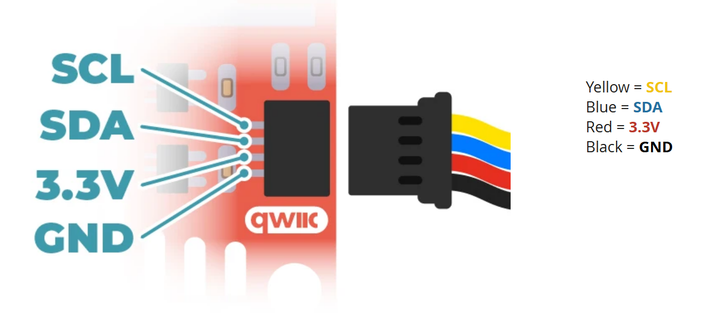

#### 2.3 - FPC Breakout Board Pinout
And this shows how the stemma cable was connected to the FPC breakout board in order for this to work. If you note the colours of the stemma cable and the CSI pinout, you'll see that it doesn't line up with the numbering on the breakout board. Why? I don't know, but this is how to connect it to work.
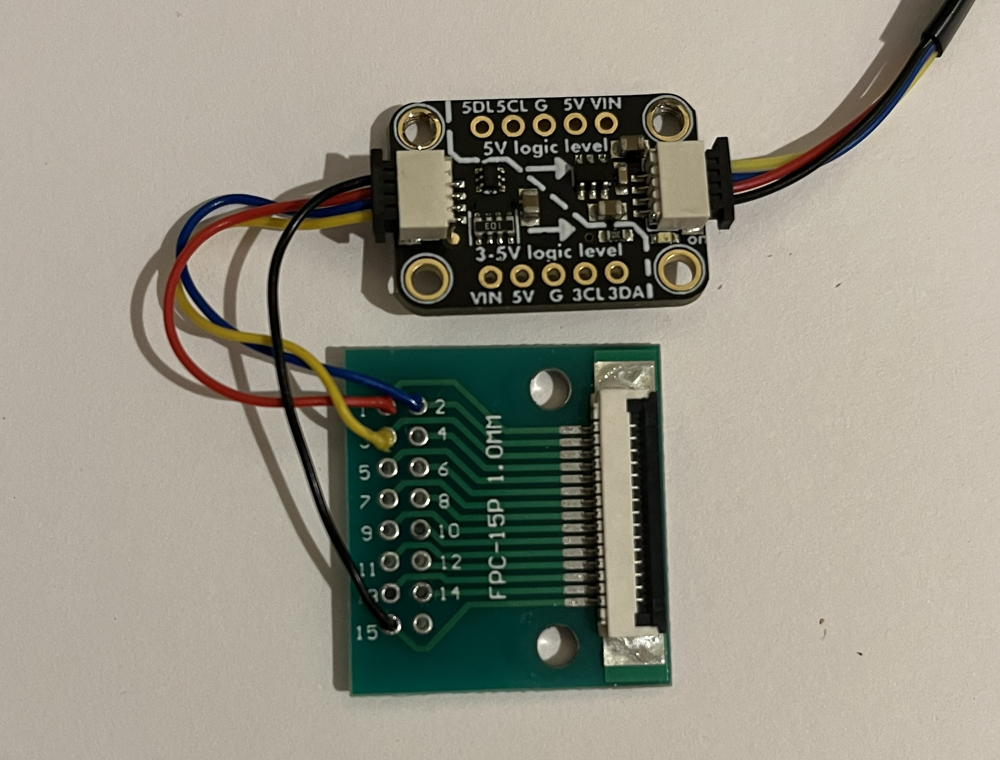

#### 3 - Stemma cables
When I did this I bought 2x stemma cables, however you only need the connector at one end of each cable, to plug into the level-shifter. So the wisdom I wish to pass on is just buy 1 10cm cable and cut it in half. One will be soldered to the breakout board and connect to the 3.3V side of the level-shifter and the other half will connect to the 5V side of the level shifter and then be soldered to a 4 core cable with dupont connectors which will connect to your LCD display.

### 4 - M3 Bolts
I used M3 bolts because I had them laying around. M3 bolts are slightly larger than the mounting holes in the Raspberry Pi, breakout board and level-shifter. Which means I used force to get them into the holes. However the end result was it threaded the hole and created a tight fit which didn't need a nut on the other side to hold everything in place. It this concerns you, you will need longer bolts to have sufficient thread to place a nut on the other side.

### 5 - Executable
The code that will be uploaded here runs in the Amiga OS, but note that if running WHDLoad/Games, multitasking pauses which means the LCD display will also pause. I am looking to create a different version of the code which will run in the Raspberry Pi so it run independently of Amiga OS, but that's for another day. Unless someone smarter than me can share some code that does this.

## Hardware Setup

The hardware set up is:

PiStorm32Lite\
&darr;\
Raspberry Pi 3A+\
&darr;\
CSI Port\
&darr;\
FPC cable\
&darr;\
FCP Breakout board\
&darr;\
Stemma cable\
&darr;\
Level shifter\
&darr;\
Stemma cable - dupont connectors\
&darr;\
I2C piggyback board\
&darr;\
1602LCD

## Hardware Assembly

### 1 - Cut Stemma cable 
Cut your stemma cable in half. So you have two halves, each with a stemma connector on one end.

### 2 - Solder Stemma cable to FCP Breakout Board (BOB)
Strip and solder one of your halves to the FCP breakout board, as shown in the table below (yes its backwards from the CSI pinout).

| Wire        | BOB pin     | Description |
| ----------- | ----------- | ----------- |
| Red         | 1           | 3.3V        |
| Blue        | 2           | I2C SDA     |
| Yellow      | 3           | I2C SCL     |
| Black       | 15          | Ground      |

### 3 - Connect FCP BOB to Level-Shifter
The other end of the BOB-Stemma cable will connect into the left 3.3V side of the level-shifter board. The level-shift board has two "sides" bottom left is the 3.3V side and top-right is the 5V side. So 3.3V is coming into the board from the left, and going out at 5V on the right. The white dash diagonal line shows the split between the 3.3V and 5V sides.

Note: 
- The Raspberry Pi output signals at 3.3V, but the LCD communicates at 5V. So we need something to change the power level of the signals. So we use a level shifter.
- And the LCD needs 5V power, but the Raspberry Pi CSI port only provides 3.3V so we need to step up the power from 3.3V to 5V.
- The Adafruit level-shift does both functions with the one board, which makes it a neat solution.

### 4 - Connect Level-Shifter to LCD
And for the other half of the stemma cable, soldered that to your 4 core dupont cable. I happened to have a 4 core which was 3 white and 1 black. I made black ground and connected the rest as per the LCD pinout so its easy for me to connect the right way. Be paranoid about getting the wiring right as it might damage your LCD.

| Wire        | LCD pin     | Description |
| ----------- | ----------- | ----------- |
| Red         | VCC         | 5V          |
| Blue        | SDA         | I2C SDA     |
| Yellow      | SCL         | I2C SCL     |
| Black       | GND         | Ground      |

Note: In this image, the level-shifter has been attached to the breakout board (this will be explained later).

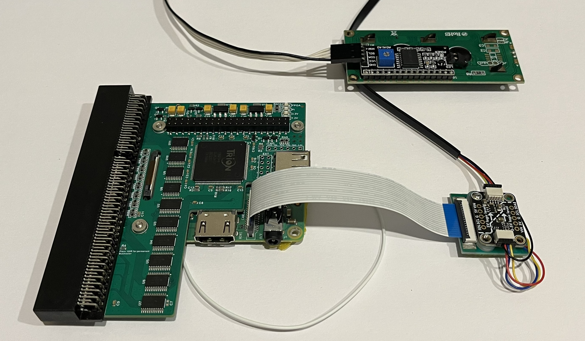

### 5 - Connect BOB to Raspberry Pi
Steps 3 and 4 are the only soldering required. That other white wire hanging off my Raspberry Pi goes to a [HDD LED adapter](https://amigastore.eu/en/979-amiga-1200-hdd-led-adapter.html). The next cable of the FPC, the image below shows its orientation in the CSI (camera port) and breakout board. Be gentle with opening the FPC connectors. The CSI is lifted vertically, and the breakout board (mine) pivots/swings up. Notice that if you laid my FPC cable flat one end would have the blue strip facing up, and the other side would have the blue strip facing down, if yours is different (same facing at each end), then your connection may differ.

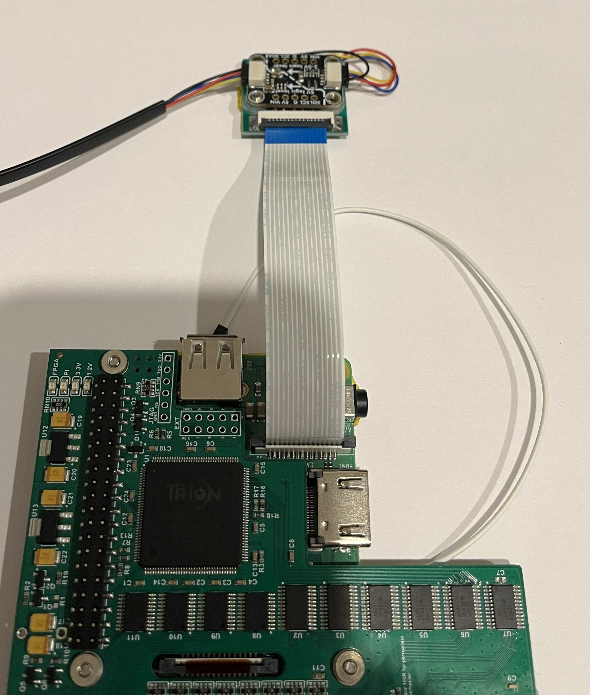

Note: At this point everything should be connected. After you double check your connections you might be inclined to test the software by going to **Software Setup** before returning to step 6 where you will mount all the boards together (Why?, in case you have to recheck your soldering).

### 6 - Mount Level-Shifter and BOB to Raspberry Pi
Again, I used M3 bolts, they are slightly bigger than the mounting holes and will cut into the boards. For me, they created a thread that made everything tight.

The images here show the level-shifter mounted to the breakout board. I used 1 M3x6mm bolt and plastic spacer to keep the boards apart. 

**Note:**
- the bolt is inserted from the bottom
- I have a second spacer on the other side ready for the M3x10mm bolt which will connect the whole lot to the Raspberry Pi board.
- I use insulation tape across the bottom of the breakout board because is exposed to the Raspberry Pi 
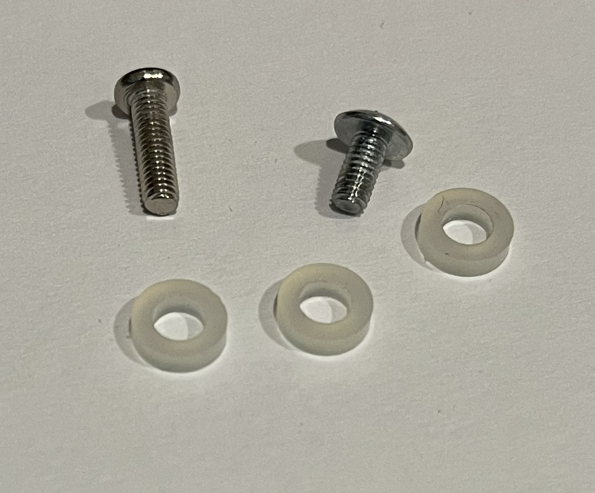
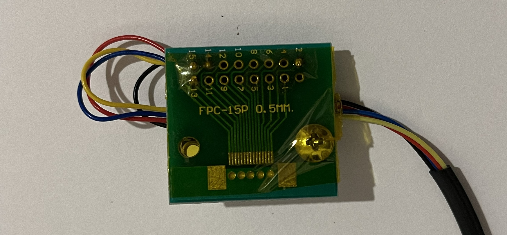
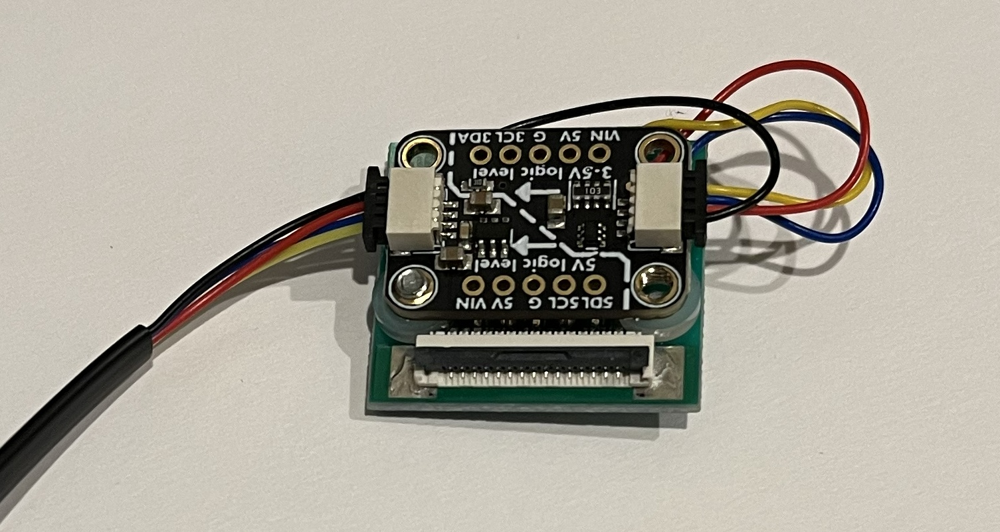

Then use the M3x10mm bolt to attach the two boards to the Raspberry Pi.

**Note:**
- use more insulation tape on the Raspberry Pi to cover the area shadowed by the boards (paranoia is ok).
- insert the M3x10mm bolt from the bottom of the Raspberry Pi
- use a spacer between the Raspberry Pi and the breakout board.

Here's a side view of the board assembly showing how its all mounted.

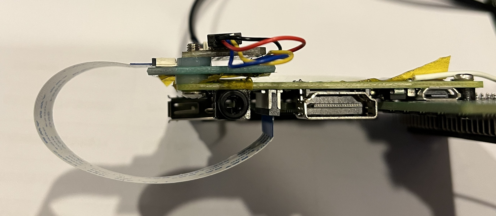

### 7 - Reinstall your PiStorm and LCD into your Amiga.
This is everything mounted back into my Amiga 1200. Again, that other white wire hanging off my Raspberry Pi goes to a [HDD LED adapter](https://amigastore.eu/en/979-amiga-1200-hdd-led-adapter.html). 

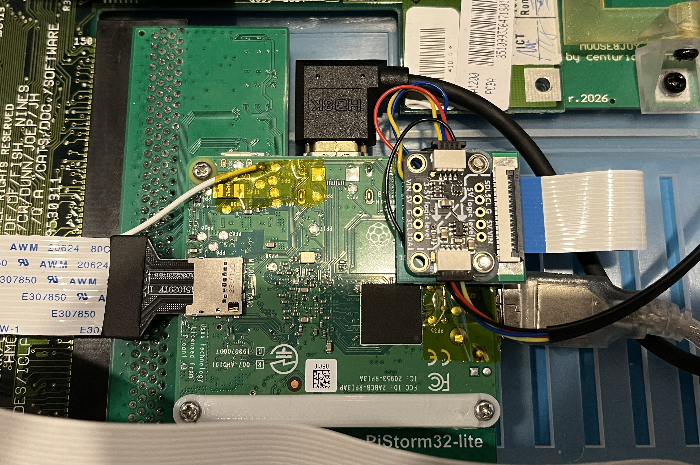

## Software Setup

### 1 - Copy the Build to your Amiga
Copy the **pistormlcd_integrated** file from the **build** folder to your Amiga C: drawer.

### 2 - Run the Build
From Workbench go the C: drawer and double-click **pistormlcd_integrated**.

**Note:**
- The LCD should have power.
- A window will open on Workbench displaying the data being retrieved, that will be displayed on the LCD.
- The LCD should look like the images below.

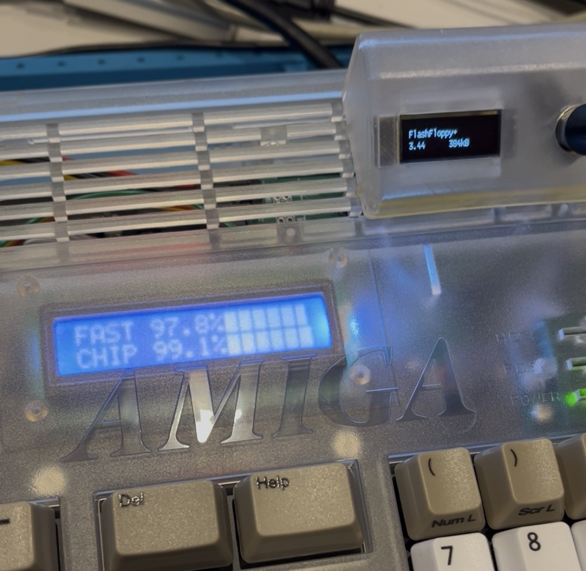 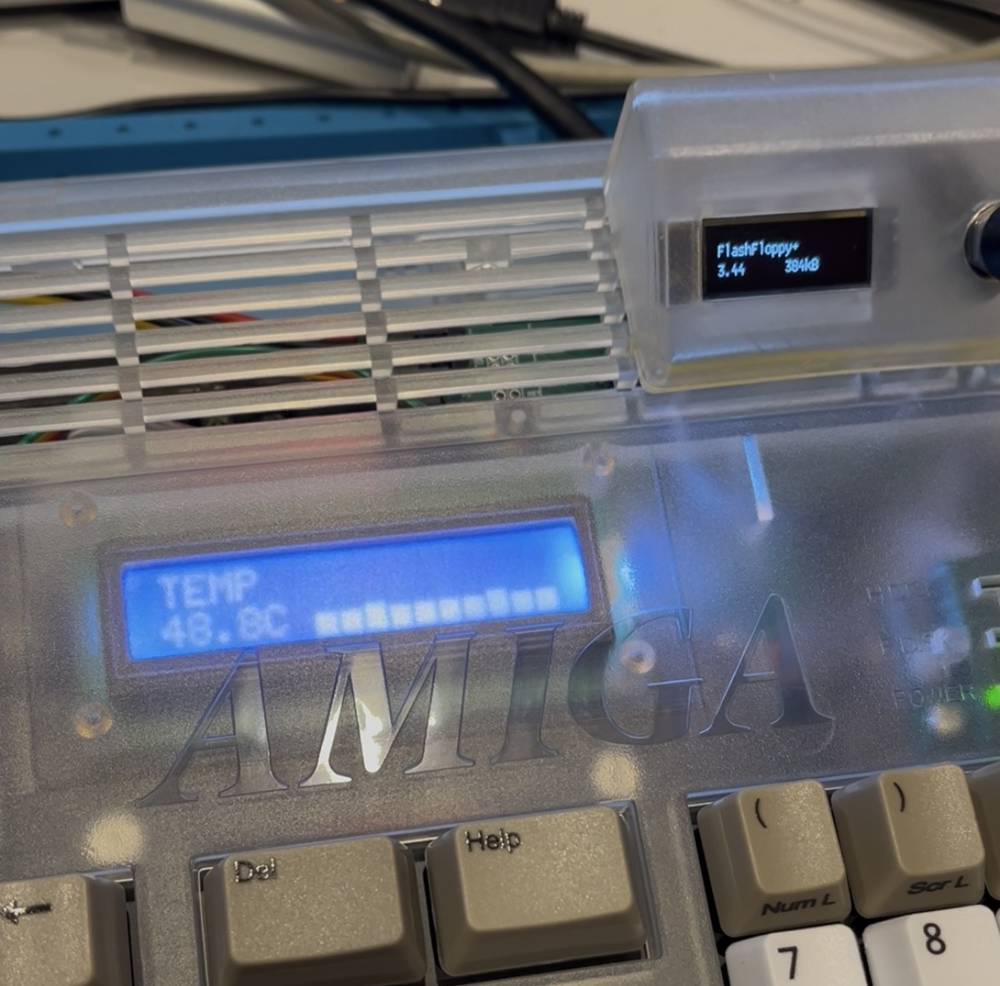 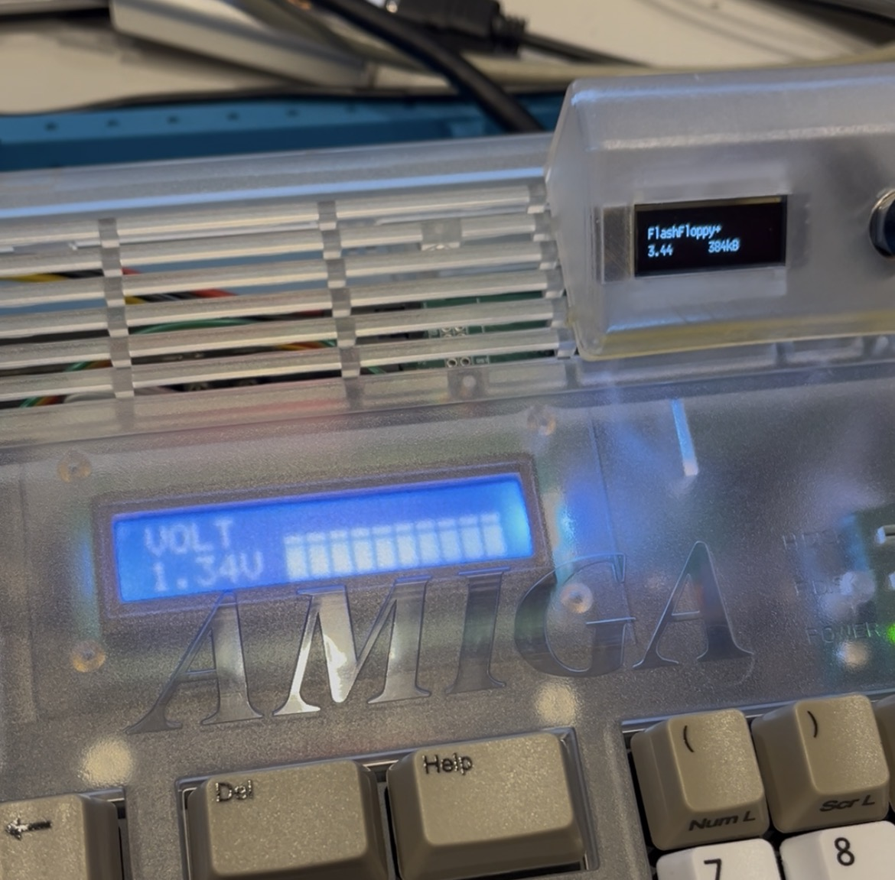

### 3 - Configure your Startup-Sequence

Go to the S: drawer and edit your user-startup file and at the bottom add

**Run >NIL: <NIL: SYS:C/pistormlcd_integrated** 

**Note:**
- Replace **SYS:** with whatever your workbench partition is called.
- This will start the LCD display program without a pop-up shell window.

## Modifying

I vibe coded all this, this is the first time I've used a compiler. So I asked the AI to create a step by step guide on how I setup my compiler (since it was done from scratch with the help of the AI) to let other newbies like me set up the same environment, download my source code and change it to their hearts content. You will find this guide in the **docs** folder.

The one thing I can tell you, the 1602LCD can store up to 8 custom characters. I used these to create in incremental vertical and horizontal glyphs for the progress bars. You can ask the AI to show you how that was done in the code.

And here's some images of me vibe coding with the AI. I used mock up LCD display screenshots created from https://chareditor.com/ to explain what I wanted. And snaps of either my Amiga workbench or the LCD to provide feedback to the AI so it knew what was working or faulty.

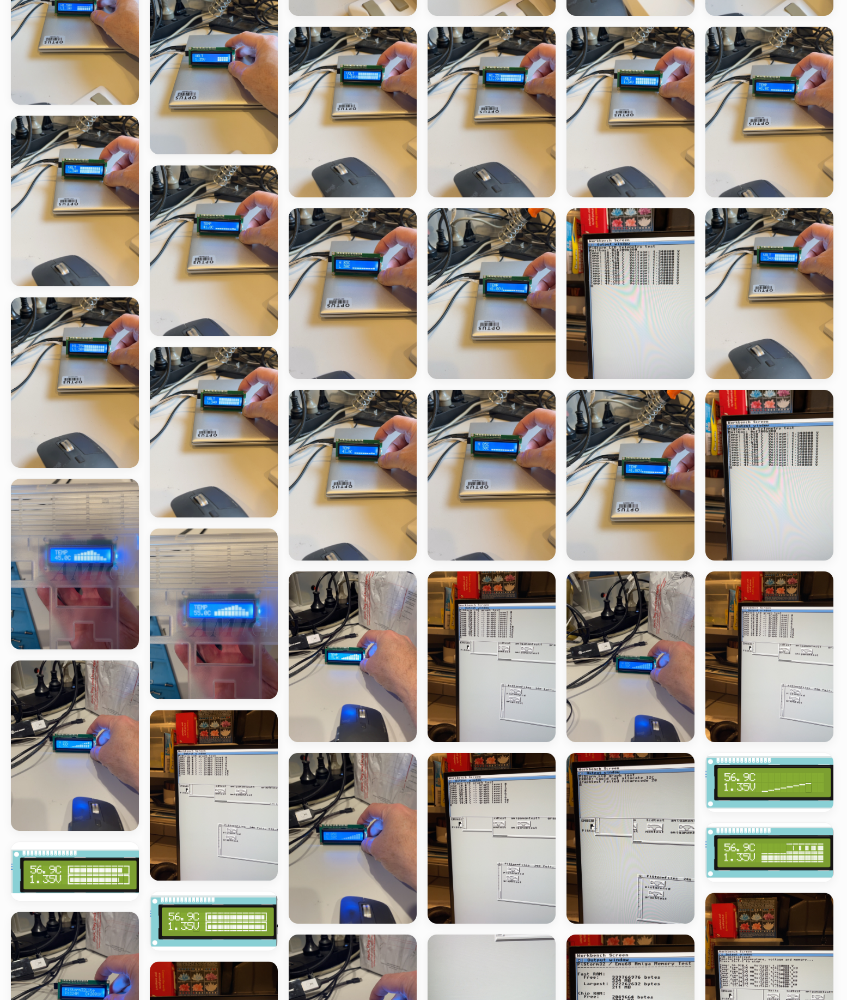

I hope that answers everything. Enjoy - Michael Gruber / Sydney, Australia.

